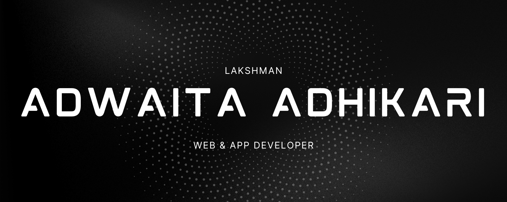

  

<h1 align="center">Hi there! 👋 I'm Adwaita Adhikari (Lakshman)</h1>

  

---

### 👨‍💻 About Me
- 🎓 Student at **DIPTI** (Daffodil International Professional Training Institute)
- 🚀 Passionate about building **modern web applications** and **cross-platform mobile apps**
- 📱 Currently diving deep into **Dart & Flutter**
- 🛠️ Tech enthusiast who loves working with **Next.js, React Native, Node.js, and Python**
- ☕ *Turning coffee into clean, efficient code!*

---

### 🛠️ Tech Stack

    
    
  

---

### 📊 GitHub Statistics

  
  

  

---

### 🌐 Connect With Me

  
  

